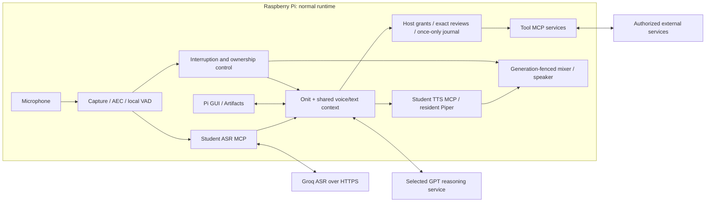

# ME3 — Full-Duplex Voice AI Agent

## Product overview, technical specifications, capabilities and performance

Reader reference: [phase/work-block labels and cited planning documents](REFERENCES/PROJECT_LABELS.md). Labels such as F5 and WB-09 identify different levels of the work plan; they are not grades.

**LOREEN ANNE P. DE GUZMAN · Student number 202521201 · AI 231**  
**Document:** owner-review draft, 7 November 2026. Collection003 stopped; collection004 has 30 locally scored stage trials and incomplete behavior evaluation; separate005 stopped at startup;006 retained nine behavior execution records;007 completed and scored the five remaining slots. All 14 selected behavior executions are recorded across separate partitions, not passed. F7 remains partial.  
**Intended repository:** [ME3_FULL_DUPLEX_VOICE_AGENT](https://github.com/loreenannedeguzman/ME3_FULL_DUPLEX_VOICE_AGENT). No commit or push before the owner's file review; repository visibility is not assumed here.

The selected Pi installation has source-manifest identity `03d7a144917edb920949c1ebaca116e277cdb55ae5c2589018334f14d522721b`, with 586 source entries and 64 native-package entries. This digest is **not a Git commit**. The measured source and evaluation adapter were frozen on 7 November 2026; the release Git commit/tag remain pending owner file approval. The separately sanitized [deployment review copy](ME3Deployment/README.md) discloses its differences and has not been admitted as a replacement installation.

## 1. Executive overview

ME3 is a Raspberry Pi 5 conversational assistant that accepts both spoken and typed requests as valid inputs. Typed text can supply a complete request or support unclear, misrecognized or unrecognizable speech by providing a name, correction or exact detail. Both input routes share the same conversation and task context. ME3 can answer questions, use tools and carry out authorized tasks. It combines a Pipecat audio pipeline, local voice activity detection, student-built speech MCP services, the original Onit task loop, a guarded execution gateway and local Piper speech synthesis.

Its purpose is to make interaction more flexible than a fixed command menu: users can explain a goal, supply missing details, change topics and inspect the resulting work. Onit remains the sole general-purpose planner. The host, rather than model prose, decides whether a tool call is permitted, whether an exact action review was completed and whether a result supports a success claim.

The Pi runs the normal GUI, conversation controller, MCP services and output path. Wi-Fi connects the configured cloud speech-recognition, reasoning and authorized external services. The engineering laptop and benchmark host are separate from normal operation. An independent fresh-install demonstration is not established by the source-restore checks.

| At a glance | Selected implementation |
|---|---|
| Main hardware | Raspberry Pi 5 Model B Rev 1.1, aarch64, four logical CPUs |
| Main reasoner | `openai_chatgpt_plan` / `gpt-6.1-sol`; no automatic model/provider fallback |
| Speech recognition | Pi-hosted student MCP server, Groq `whisper-large-v3-turbo` inference |
| Speech synthesis | Pi-hosted student MCP server, local resident Piper |
| Voices | English `en_US-ljspeech-medium`; female Spanish `es_ES-sharvard-medium` |
| Interface | Authenticated normal GUI on Pi port 8765, voice, text and Artifacts |
| Accepted final scope | Owner-accepted supported functional exit, including the final WhatsApp submission and observed automatic close |
| Remaining gates | Review of weak/limited benchmark results and unavailable measures, final package review and authorized publication |

This is a supported-scope product report, not a claim that every master requirement, network condition or possible task has passed.

## 2. Product features and capabilities

### Voice and typed text are valid inputs

The GUI text box is an alternative way to communicate with the agent, not merely a display or setup field. If a spoken word or request cannot be recognized, type the intended request or clarification and submit with Enter/Send. Continue by voice in the same conversation. Typed text bypasses ASR for that input, but does not bypass reasoning/tool connectivity, permissions or exact action confirmation. A typed correction is a new contextual message; it does not edit the old transcript.

### Spanish translation and spoken output

Owner trials demonstrated drafting a Spanish letter from an English description, translating a passage into Spanish, contextual Spanish replies and language-appropriate farewells. A request or the conversation context can select Spanish without a language button. These are finite owner observations, not a formal translation-quality score or a claim of perfect bilingual conversation.

The main reasoning model prepares the answer/translation. Its existing final-answer presentation can carry ordered segments tagged `en` or `es`; the host validates them and the TTS service selects the matching resident Piper voice. English uses `en_US-ljspeech-medium`; Spanish uses `es_ES-sharvard-medium`, with female speaker ID 1. They are separate voices, not one voice identity speaking both languages. The earlier English-accented Spanish readout and male Spanish voice preceded the selected female configuration; the owner subsequently confirmed hearing the female voice. This does not establish an objective pronunciation rating.

Spanish output does **not** establish automatic multilingual speech recognition. The current ASR path is configured for English; Spanish speech was sometimes captured as English during the live exchanges. A typed Spanish request, exact wording or correction is an alternative when speech is unclear. The benchmark did not measure Spanish recognition, translation accuracy or Spanish voice naturalness. Other spoken languages, including Tagalog, have no qualified installed voice in this profile. No separate translation service or new provider is introduced by documenting this capability.

Implementation: [language-tagged presentation](ME3Deployment/onit_candidate/speech_presentation.py), [voice selection and validation](ME3Deployment/speech_mcp/tts_config.py), and [voice-asset identities](ME3Deployment/provenance/voice-assets.json).

### Conversation and duplex interaction

ME3 captures input while speaking and uses generation, task and capture ownership to suspend, continue or replace speech. A listening acknowledgment can preserve the current answer; a correction can invalidate obsolete output and introduce a new goal. Voice and text share conversational context. These mechanisms do not identify an unknown speaker or reliably determine directedness from audio under every condition.

The optional warm floor lane uses the existing native Onit path with a tool-free Qwen advisory role. It cannot grant action authority, accept a pending confirmation or become a second general-purpose planner. Exact pending reviews retain their host controls. Early confirmation during an incomplete review produces a nonexecuting explanation; the user must hear the exact review and confirm separately.

Automatic fixed acknowledgments and their startup cache were retired after owner feedback. Model-generated conversational wording is separate from immutable host reviews. Local English and Spanish output are supported; Spanish TTS does not establish multilingual ASR qualification.

| Domain | Demonstrated or implemented scope | Evidence boundary |
|---|---|---|
| Research | Requested web search, Wikipedia, weather and registered publisher feeds | Actual source links/readbacks; provider availability and snippet completeness remain limitations |
| Personal productivity | Local tasks, notes, calendar and reminders; basic timed events on the selected Google primary calendar | Scope-bound reads/changes, exact review and separate confirmation; no automatic local/cloud synchronization |
| Coding and artifacts | Owned-workspace files, unfamiliar-project repair, finite multi-file applications, bounded tests/services, file and ZIP delivery | Historical source-specific software proofs and owner artifact observations; not arbitrary host execution or production-security certification |
| Media | Local catalog/playlists and explicitly selected online media integrations | Supported, authorized operations; external sites and browser state can fail |
| Communication | Guarded WhatsApp and Gmail operations, with supported calling handoff | Commanded access, exact recipient/content or read-scope review, separate confirmation and outcome verification |
| Conversation context | Follow-up, topic return, voice/text handoff and retained response continuation | Same-session scope; durable restart recovery is separately limited and its optional startup flag remains off |

The final owner441 message operation is host/Gateway **VERIFIED**, with backend **SUBMITTED**, a message identity and an exact-message observation. The owner accepted the send and automatic close. This does not establish recipient read status or delivery guarantees for future messages. A later redundant-close request was **NOT_DISPATCHED** and the GUI conversation stopped; that accepted limitation remains recorded.

### GUI and tools

The interface supports typed input as an alternative to voice and displays successfully recognized speech as user text. Both input routes use the same conversation and task context. The composer accepts Enter/Send, with Shift+Enter for a newline; a typed correction supplies a new clarification rather than editing the earlier transcript. **Copy conversation** copies the displayed user/assistant exchange, including reply-state labels. It does not export audio or internal journals. Recognition errors, interrupted speech and service notices remain visible limitations. See [the GUI voice/text guide](<4 - ME3_GUI_VOICE_TEXT_GUIDE.md>) for controls, context behavior and implementation links.

The GUI presents the conversation, task outcomes and Artifacts. Owner-click file/ZIP delivery and sandboxed static preview are distinct from a private application service's network namespace. Closing a preview does not automatically stop its backend. The final GUI image and actual hardware photographs are not included in this draft; they must be actual captures, never illustrative substitutes.

MCP operations are admitted through their real schemas and the current grant. Configured integrations are not blanket permission to inspect contacts, inboxes or accounts. Consequential operations retain exact reviews, separate current confirmation, once-only journals and independent verification. An uncertain or consumed operation is not automatically retried.

### Configured task-server set

The [task-server configuration](ME3Deployment/config/assistant.json) contains the following 14 categories. They are configured MCP servers, not individual function-call names or proof that every operation is available or live-qualified. Provider setup, scoped grants, current service availability and the evidence boundaries above still apply.

| Server category | Configuration ID |
|---|---|
| Utilities | `utilities` |
| Shopping | `shopping` |
| Library | `library` |
| Music | `music` |
| Reminders | `reminders` |
| Research | `research` |
| YouTube | `youtube` |
| SoundCloud | `soundcloud` |
| WhatsApp | `whatsapp` |
| Workspace | `workspace` |
| Calling | `calling` |
| Productivity | `productivity` |
| Gmail | `gmail` |
| Google Calendar | `gcalendar` |

## 3. Technical specifications

### Observed hardware and software

| Item | Observed fact | Limit |
|---|---|---|
| Board | Raspberry Pi 5 Model B Rev 1.1 | Kernel-reported model, not a new board test |
| CPU / memory | Four logical CPUs; 8,449,769,472 bytes reported RAM | No inferred CPU clock or sustained resource measurement |
| Platform | Debian GNU/Linux 13 (trixie), aarch64; kernel `6.18.50+rpt-rpi-2712` | Distribution identified in the final read-only `/etc/os-release` snapshot; no OS image was rebuilt |
| Storage filesystem | 125,364,555,776 bytes total; 79,261,523,968 available at observation | Filesystem figures do not identify the physical storage device |
| Network | `wlan0` up; Ethernet down at observation | No bandwidth or reliability guarantee |
| Audio identifiers | USB `08bb:2902` and two HDMI audio cards observed | Manufacturer/model, cable mapping and physical assembly need direct evidence |
| Temperature | 47.4 °C at the observation | One instantaneous value, not typical/peak thermal performance |

The [hardware provenance](ME3Deployment/provenance/hardware-observed.json) was obtained without opening audio devices, making network probes or invoking a provider.

| Software layer | Observed identity / role |
|---|---|
| Main interpreter | CPython 3.13.5 |
| Pipecat / MCP | 1.12.0 / 1.26.0 |
| HTTP / numerical / local inference libraries | aiohttp 3.14.5; NumPy 2.5.4; ONNX Runtime 1.24.4 |
| Audio libraries | PyAudio 0.2.14; soundfile 0.13.1; separate WebRTC AEC shim |
| Piper environment | Separate Piper 1.8.0 environment, CPU profile with two threads and no spin |
| Onit | Pinned upstream commit `e0bbe9179b39ca3e928bf2d83ae972d3df6bb6c5`, verified archive identity |
| Normal reasoner | Selected account-backed `gpt-6.1-sol`, distinct from historical/configuration alternatives |

The complete observed inventory is in [dependency identities](ME3Deployment/provenance/dependency-identities.json). Version presence is not proof that a new environment was installed or native libraries were rebuilt. Historical `config/m7_asr.json` and legacy model constants are not authoritative for the selected normal ASR/reasoning path.

Network access and private credentials are needed for cloud ASR, main reasoning and relevant external tools. Local Piper and VAD run on the Pi. Installation footprint, startup distributions, power and acoustic performance have not been measured. Section 5 reports the bounded existing collection004 CPU/memory samples, not a general sustained-load qualification.

## 4. System architecture and technical workings



The student ASR server converts accepted captured audio to a bounded recognition request. Validated text enters the shared Conversation and original native Onit loop. Tool declarations describe available work; Onit chooses within the current host grant. The host validates arguments, identities, current generation and operation state before dispatch. Verified results return as evidence. Validated response text then enters local synthesis and paced PCM output.

When new speech arrives, provisional suspension and confirmed ownership changes are distinct. Stale ASR/model/playback results cannot acquire a newer turn merely because they finish later. Bounded worker retirement precedes a replacement where required. An interruption never undoes an already completed external action, and a listening acknowledgment never confirms one.

The configured task server set includes utilities, shopping, library, music, reminders, research, YouTube, SoundCloud, WhatsApp, workspace, calling, productivity, Gmail and Google Calendar. The two student speech interfaces supply ASR and TTS separately. Service details are in [the configuration](ME3Deployment/config/assistant.json); private prepare/commit endpoints are host-fenced rather than general model tools.

Local and external work must be distinguished: VAD, context, gateway, student MCP processes and Piper are Pi-local; normal ASR and reasoning inference are hosted. Browser/account tools may depend on external sites. The laptop is used for engineering and digital benchmark transport/scoring, not as the Pi's normal launcher or second assistant.

Physical wiring is not inferred from configuration. The current routing configuration describes USB microphone/HDMI output selection; actual device models, ports, power supply and wiring photographs remain to be documented.

## 5. Performance and benchmark results

**Collection004 completed its 30 stage trials and then stopped on the first behavior trial. F7 is not complete.** Local scoring and analysis are complete for the available stage records; they do not establish all-pass behavior or a complete benchmark. The queue contains 30 done, 1 failed and 9 pending items. Across the 44 planned execution slots, analysis classifies 30 as SCORED_TIMING, 1 as INFRASTRUCTURE_ERROR and 13 as UNSTARTED. Twelve of the 30 stage trials have the course audio-detection label “no reply.” None was silently discarded or replaced. [Detailed results and provenance](Benchmarks/BENCHMARK_RESULTS.md) retain both this cohort and the separate stopped003 attempt.

The updated course commit is `57eaddbc188ce9a19b8fd002b575f703426956f4`. The measured source was frozen at **2026-11-07 05:10:18.808709 +08:00**, manifest `45c0d2f64df256aac2fa0c221abeb8e94f78d3b53da3a9f7eb8065ef66a1d43c`. Adapter004 has a separate freeze addendum `3c35d27b09bec7916c7ff37d02250305be26acb45cbf12859e5cc98081f26e6b` and contract `0494e2928e1f6aabde7e2bb986cde77bad28fb3bbc19f728667c22d16b4f8fbb`. Normal source, models, reply windows and dataset were unchanged. Seed 0 selected 10 stage phrases × 3 runs plus one behavior round: 40 queue items / 44 execution slots. Earlier historical 31-trial results are excluded.

### Collection004 observed stage distributions

All times are seconds. Mean, P50 and p95 describe **only records with an observed value**. Missing values are not zero-imputed. The denominator for every row is the same 30 stage trials.

| Course stage metric | Observed N / 30 | Missing | Mean | P50 | p95 |
|---|---:|---:|---:|---:|---:|
| Producer-mark E2E (`e2e`) | 21 | 9 | 6.4393 | 6.4977 | 7.3566 |
| Course detected-audio E2E (`e2e_heard`) | 18 | 12 | 7.2858 | 7.3480 | 8.0136 |
| Endpointing | 30 | 0 | 0.6669 | 0.6355 | 0.6912 |
| ASR final | 30 | 0 | 0.7903 | 0.6018 | 1.3155 |
| LLM first text | 24 | 6 | 4.7732 | 4.7321 | 6.1688 |
| TTS first PCM | 21 | 9 | 0.5065 | 0.5459 | 0.6944 |

The name `e2e_heard` is the course's digital audio-detection metric, **not measured physical audibility**. Producer/audio onsets do not independently establish substantive or complete replies. Its p95 has only 18 observations and is near the slowest sample. The pinned course median intervals use 1,000 iid-trial bootstrap samples, seed 0; separate phrase-cluster sensitivity intervals are labelled supplemental in the detailed results. Missingness can bias observed-value latency distributions; these are not unconditional service guarantees or proof of an eight-second target.

Local transcription scoring made 30 attempts under the frozen 52-attempt ceiling, using CPU/int8 `Systran/faster-whisper-small` at pinned revision `536b0662742c02347bc0e980a01041f333bce120`, two threads, without network/provider calls or production mutation. This scorer is distinct from normal Groq ASR. Across 198 reference words, 35 edits give pooled WER **17.68%**; the unweighted mean of per-phrase WER values is **20.03%**. These figures cover this fixed stage corpus, not general accent/noise/language performance; CER is not reported.

The first behavior execution failed while the normal generation-1 output buffer was intentionally SUSPENDED, retaining 5,760 bytes / 120 ms. The digital adapter's blanket two-second output-writer timeout fired before the cut-in ended. The wire pump continued at 20 ms cadence through 06:16:32, with no wire error. This is an identified **benchmark-adapter fault**, not proof that normal production interruption failed. Final cleanup and evidence export were verified. Adapter005 subsequently passed one focused actual-Pi qualification case with nine assertions and was separately frozen. Its authorized collection **STOPPED before the first trial**, during `prepare_speech_worker`: ASR worker readiness recorded a DNS-stage TimeoutError, with `automatic_retry=False`, `audio_opened=False` and zero inference requests. Startup credential preparation also recorded a failure. MCP services had connected, but that did not establish external readiness. This is a startup DNS-readiness observation, not a global provider-outage diagnosis or a scored behavior failure. Cleanup/export were verified; 0 executions completed, scoring was NOT_RUN because no eligible trial data existed, and counters remained 1049 / 2065 / 2453 / 2. That stopped attempt was retained without automatic retry; subsequent 006 and the owner-requested007 continuation are separately scoped. Source/models/windows are unchanged;005 is not merged into004.

| Other result family | Actual report state |
|---|---|
| Pause/turn-taking and false/missed rates | 004 had no eligible behavior result; partial 006 scores are reported below with their exact small denominators |
| Digital barge-in / acknowledgment continuity | No eligible measured latency or judge-validated continuity result |
| Judge-dependent semantic interruption/context behavior | NOT_SCORED; zero judge calls after the selected judge readiness timeout |
| Detection precision/recall | NOT_MEASURED; no independent frozen opportunity/prediction mapping |
| Physical audible stop/onset | NOT_MEASURED; digital events are not acoustic measurements |
| Voice ratings / power | NOT_MEASURED; bounded sampled resource observations are reported below |
| Optional UTMOS | NOT_SCORED; disabled |

### Collection006 partial behavior results

Collection006 used the same frozen normal source and a separate behavior-only contract, `5482c29a07d76b2e5cdfc5f0d9b56827541c0eb51a219af76b0bc1fd576d5670`. It stopped with **7 queue items done / 3 pending**, corresponding to **9 SCORED_TIMING records / 5 UNSTARTED execution slots**. Eight sessions completed verified peer resets. The ninth produced valid trial timing but no subsequent peer reset: the pinned upstream runner entered its keyboard pause after five consecutive reply-expected records with empty bot segments. The noninteractive `--no-live` launch hid that prompt. The normal assistant later answered, drained output and remained listening until its 180-second session cap, with verified cleanup and no pipeline fault. This stop is not an attributed normal pipeline failure; the **five genuine no-reply labels within their original trial windows remain**.

The final offline course scores, not provisional live symbols, are:

| 006 measure | Final observation | Boundary |
|---|---|---|
| False turn-taking | **1 / 2 = 50%** | Side-talk 1/1; TV/radio 0/1; tiny sample, not background/speaker precision or recall |
| Synthetic-pause turn-taking (`tor`) | **0 / 1** | One supplied synthetic-pause case |
| Turn-taking (`tor`) / missed rate | **0 / 1** / **1 / 1** | One missed turn in the supplied case |
| v1 interruption | **1 overlap not played** | No eligible stop/response-latency estimate |
| Judge-dependent semantic behavior | **NOT_SCORED**, 0 judge calls | No inference of successful respond/resume from marks |

Offline word-count scoring changed the approximately 0.9-second side-talk audio's provisional “silent” indication into the final false-turn-taking result. No result was replaced. Nine local transcription attempts completed without network/provider calls or raw-input changes. Small denominators do not support a general rate claim; physical audibility and detection precision/recall remain unmeasured. Usage after006 is **1058 ASR / 2074 reasoning / 2477 TTS / 2 commit_item**. No new stage timing/WER population was collected:004 remains separate.

### Collection007 completed remaining coverage

At the owner's request,007 recorded and locally scored only the three remaining queue items / **five execution slots**, with **zero unstarted slots**. Four of these five records retain no-reply labels. Candor-pause TOR is **0/1**; the v15 interruption and backchannel main cases did not play their overlap, leaving eligible stop/resume/response-latency populations at **N=0**. These are weak timely-reply outcomes, not successes obscured merely by judge unavailability. No semantic judging or physical precision/recall is established.

The coverage check proves 006's first seven queue items /nine execution IDs and 007's last three /five IDs are **disjoint**, with all 14 selected behavior IDs recorded. It does not prove 14 passes, one uninterrupted run or pooled performance. 004's 30 stage trials remain separate. 007 used contract `f5dfd1b9b03ee5cfc1172a7e8c91610b52a075a57815fe73f4195ec4104fcb46`; only the bounded launcher/cap/plan files differed, with unchanged normal source and 005 audio-adapter behavior. It had four reply-expected executions, avoiding 006's five-miss keyboard-pause branch rather than fixing that upstream branch universally. Cleanup/export were verified. Final Pi usage is **1064 ASR /2080 reasoning /2487 TTS /2 commit_item**; independent laptop counters are unchanged. No new runs are planned; F7 remains **PARTIAL**.

Thirty stage trials do not guarantee statistical reliability, and one behavior round yields very small denominators. No warm-up trial is discarded post hoc and no P99 is claimed. Missing responses and unavailable measures stay visible; successful owner demonstrations do not substitute for the weak benchmark outcomes.

### Collection004 resource and context observations

These are existing run-statistics outputs, not a new load test. Pinned course `probe.py` and `score/resources.py` define whole-machine CPU as the average utilization across the four cores and memory from procfs. The resource stream covers the entire stopped run, including idle/gaps and the failed behavior attempt: 904 samples across 1,003.3701 seconds. CPU has 874 non-null observations and 30 initialization/missing values; memory has 904. Aggregates are sample-weighted, not time-weighted.

| Observation | Measured value | Population / limit |
|---|---|---|
| Whole-Pi CPU | Mean 11.7846%; P50 2.50%; p95 44.95%; observed max 83.50% | 874 observed samples / 904; not assistant-only CPU or an active-turn average |
| Available system memory | Observed minimum 5,251.3 MiB; total reported 8,058.3 MiB | 904 samples; MemAvailable is not exclusive application RAM |
| Answering-call prompt/context tokens | Median 4,990; max 4,993; first 4,989 / last 4,985 | 20 eligible LLM calls with usage-reported token counts; message counts unavailable |

These observations do not establish power use, a universal peak-memory bound, long-session context retention or a CPU cause for provider waiting. Resource collection includes the probe's own overhead and does not continuously cover every instant.

The selected Gemini `gemini-3.8-flash` judge's one readiness attempt timed out after 34.986999 seconds without an HTTP status. Protected state and normal/benchmark budgets were unchanged. This cohort has zero judge scoring calls, not a semantic score of zero or pending permission to retry. The original five-call ceiling remains unused.

Collection003 remains a separate failed attempt with zero completed Pi executions. Its first raw “no reply” record was a late response: capture ended at 9.792 s before complete PCM at about 9.98 s. A subsequent greeting/listening barrier and cleanup failure stopped that cohort. The raw labels were not rewritten as passes. Collection004 results are not merged with it, owner conversations or software fixtures. No numerical naturalness rating, overall grade or whole-F7 acceptance is assigned.

## 6. Actual demonstrations

The evidence includes finite voice/text conversations, artifact previews, tool-backed information lookup, scoped productivity/media operations and guarded communications. Earlier unfamiliar-project repair and a multi-file application have retained source-specific software checks; the vault application's 11 passing checks are not owner GUI acceptance or a security audit.

The final supported F5 exit is owner441's observed WhatsApp submission and automatic close, corroborated by the operation states described in section 2. Earlier Gmail automation and messaging scopes remain separately retained. The redundant-close failure and prior uncertain operations were not erased or replayed to obtain this acceptance.

The [GUI voice/text guide](<4 - ME3_GUI_VOICE_TEXT_GUIDE.md>) includes the operating controls and standalone Pi demo preparation. It must use the normal Pi launcher and Wi-Fi, not the laptop benchmark transport. Do not resend historical messages merely to demonstrate the system. Fresh demonstration actions retain their ordinary privacy and confirmation controls.

## 7. Limitations and constraints

- Cloud ASR/reasoning and external sites depend on connectivity, account access and provider capacity. A single readiness pass would not guarantee later service.
- The final redundant WhatsApp-close request could stop the conversation; the owner accepted this remaining limitation. Submitted does not mean read.
- Natural directedness, accents, noise, long conversations and speaker identity are not universally qualified. English ASR and bilingual synthesis have different scopes.
- Task recovery, background execution and application delivery are bounded. The normal `--task-recovery` option remains off; source files and same-session context do not prove arbitrary crash recovery.
- WB07/WB09 and other incomplete master criteria remain scoped/partial; WB08 is owner-deferred. The supported F5 exit is not whole-project or all-master acceptance.
- The publication copy excludes private prerequisites and contains disclosed substitutions. It is not already authorized or a proven clean-machine installation.

## 8. Deployment and operation overview

Use the separate [ME3Deployment guide](ME3Deployment/README.md), [setup](ME3Deployment/SETUP.md), [operation](ME3Deployment/OPERATING.md) and [reproduction limits](ME3Deployment/REPRODUCIBILITY.md). Provision the required Pi environments, exact Onit source, voices/native libraries and the new operator's credentials/authority. No real account state, active grant, consumed token or model weight is included.

The reviewed normal entry shape is:

```sh
cd "$HOME/ME3Deployment"
PYTHONPATH="$PWD/tools:$PWD" ME3_PROJECT_ROOT="$PWD" PYTHONDONTWRITEBYTECODE=1 \
  .venv/bin/python -P -B -X utf8 -m onit_candidate.gui \
  --port 8765 --warm-floor --validated-delivery --background-ready
```

An audit of 11 relevant source paths confirmed Pi-local reasoning/authentication and direct HTTPS provider connections, with no Codex desktop process required by the normal runtime. This is static source evidence, not a fresh OS installation or a new standalone audio trial. Credentials, DNS and provider prerequisites remain.

The project-only environment matches [OPERATING.md](ME3Deployment/OPERATING.md): `-P` does not add the current directory automatically, so the explicit `tools` and project paths are required. It does not depend on a laptop path or a global Python setting. Run from the Pi-local project directory and open the local GUI on the Pi. The microphone remains owner-controlled. A startup command does not bypass missing source/configuration/grant prerequisites. Stop through the normal GUI/session controls and wait for verified owned cleanup. Never reset counters or repeat an uncertain action as a recovery shortcut.

## 9. Engineering quality and reproducibility

The private source archive SHA256 is `9e41057d450bcedc39b89d9b1e19f88803de441182f2210babae2c2cd66acb23`. An isolated restore passed seven groups: source hashes, native-index bytes, native-member hashes, indexed Python parsing, production candidate validation, production source validation and pure imports.

Two private policy/governance prerequisites were separately provisioned locally with mode 0600. The archive alone was insufficient. The restore initialized no services, authentication, provider calls or physical audio and did not rebuild compiled dependencies. These are source-integrity results, not a clean OS/runtime installation. The subsequent scoped F6 freeze combines them with the accepted installed candidate, exact identities, operational configuration and adapter evidence. Adapter003 adds one actual-Pi provider-free case and explicitly reuses seven prior Pi checks; it is not eight new tests, a full-suite rerun, live provider qualification or a new environment installation.

Publication identities are separate in [publication deltas](ME3Deployment/provenance/publication-delta.json). The independent laptop source/ledgers were held separately; Pi adoption is not inferred from copying report files. Exact action journals, failed charges and once-only identities remain private engineering evidence.

## 10. Future development

Priorities include reducing measured provider/turn waiting, improving natural pacing and context-aware interruption under more conditions, stronger bounded recovery, more reliable external-site lifecycle handling and a reproducible operator provisioning process. Improvements require their own evidence and a new candidate identity when they affect measured behavior. They are not existing benchmark results or implicit permission for more services/models.

## 11. Conclusion

ME3 combines a real Pi-hosted voice/task architecture with the original Onit planner, student speech MCP services, local VAD/Piper and a host-controlled execution boundary. Finite conversations and tasks demonstrate useful supported operation, culminating in the owner-accepted send/autoclose result. Network failures, redundant-close behavior, limited reproduction scope and incomplete measurements remain explicit. Final benchmark conclusions and publication acceptance await actual evaluation and the owner's file review; no numerical grade is claimed.

## 12. References and supporting resources

1. [Deployment provenance and reproduction scope](ME3Deployment/REPRODUCIBILITY.md), including source/native/archive identities.
2. [Dependency and asset/license inventory](ME3Deployment/DEPENDENCIES_AND_LICENSES.md).
3. [Actual main prompt and host policy](ME3Deployment/onit_candidate/engine.py), [selected reasoner](ME3Deployment/onit_candidate/reasoning_profile.py), [normal ASR](ME3Deployment/me3_assistant/groq_backend.py), and [voice assets](ME3Deployment/me3_assistant/voice_profile.py).
4. [Engineering history](<5 - ME3_ENGINEERING_HISTORY.md>) and [reference-original disclosure](REFERENCES/README.md).
5. Course benchmark repository, commit `57eaddbc188ce9a19b8fd002b575f703426956f4`; method/adapter/configuration frozen under the identity in section 5; retained stopped-cohort receipts summarized in [BENCHMARK_RESULTS.md](Benchmarks/BENCHMARK_RESULTS.md).
6. Official project documentation: [Raspberry Pi](https://www.raspberrypi.com/documentation/), [Pipecat](https://docs.pipecat.ai/), [MCP](https://modelcontextprotocol.io/), [Groq](https://console.groq.com/docs/), and the exact upstream/model licenses retained by the deployment inventory. These identify sources; no unverified hardware specification or measurement is imported from them.

### Appendix A — Assignment traceability

| Requirement | Implementation / evidence | Boundary |
|---|---|---|
| R1 Pi harness / student MCP paths | Normal Pi GUI, Pipecat, real MCP lifecycle | Supported installed scope; source restore separately bounded |
| R2 ASR MCP and suitability | Student server, actual Groq Whisper path | Fixed 30-stage corpus WER reported; broader language/noise scope unqualified |
| R3 TTS MCP and suitability | Resident Piper, exact English/Spanish assets | Local synthesis and finite owner observations; no invented rating |
| R4 Local VAD / capture during output | Local detector, AEC and generation-fenced output | Software/owner scopes; acoustic measurements separate |
| R5 Natural interruptible conversation | Shared context, pause/overlap/continuation controls | Supported F5 exit, not universal conditions |
| R6 General tasks / verification | Granted tools, artifacts and once-only actions | Source-specific scopes; partial/deferred requirements retained |
| R7 Standardized evaluation | Frozen updated course source and adapter | Collection003 stopped; no aggregate metrics; judge metrics NOT_SCORED |
| R8 Integrity / security / reproduction | Source checks, accounting, exact reviews, bounded restore | No production-security certification or clean install claim |
| R9 Explanation / handover | Three report layers and presentation guide | Student mastery is not inferred from these documents |

### Appendix B — Hardware and connections

Use the observed table in section 3 and the provenance file. Actual assembly photographs, peripheral model labels, power details and verified physical port mapping remain required; configuration is not a wiring photograph.

### Appendix C — Software, models and licenses

Use the dependency, voice-asset and source manifests linked above. Retain separate main/Piper/Onit environments. Installed Davefx assets are not the selected Spanish voice or a fallback. Project redistribution licensing remains an owner decision; individual notices/checksums do not license unrelated code or weights.

### Appendix D — Benchmark methodology

The F6 manifest binds the updated method, supplied prompts/scorer, adapter, dataset/license/checksums, seed/rounds/reset, privacy profile and exact candidate. Collection003 stopped and its observations remain in [BENCHMARK_RESULTS.md](Benchmarks/BENCHMARK_RESULTS.md). Adapter004 has its own qualification/freeze addendum; collection004 is distinct, stopped after its 30 stage trials, and locally scored. Its first behavior execution failed on an adapter output-writer timeout; the remaining behavior executions were unstarted. Do not overwrite or merge the stopped cohort. Separate course metrics from added engineering/functional metrics and physical experiments. Disclose any model, scoring or transport deviation.

### Appendix E — Detailed results

See [BENCHMARK_RESULTS.md](Benchmarks/BENCHMARK_RESULTS.md) for actual collection004 timing, uncertainty, missingness, WER and evidence identities. Stage results cover 30 trials, including 12 course no-reply labels; 1 behavior execution failed and 13 execution slots were unstarted in004. Separate006 records nine behavior execution IDs and 007 records the five remaining IDs, without overlap or pooled scoring; recording all 14 does not mean14 passed. Judge-dependent metrics are NOT_SCORED, with zero judge calls. No behavior all-pass, physical audibility or precision/recall is asserted. Collection003 and the historical 31-trial run remain separate; no synthetic or replacement trials fill missing values.

### Appendix F — Glossary

**MCP:** typed client/server tool interface. **VAD:** voice activity detection. **ASR:** speech-to-text recognition. **TTS:** text-to-speech synthesis. **Barge-in:** user speech during assistant output. **Generation fence:** rejection of results/output belonging to an obsolete turn. **Verified submission:** operation-specific evidence of submission, not a blanket delivery/read guarantee. **TTFT/TTFB:** explicitly defined first-text/first-byte observations, not acoustic onset. **Full duplex:** concurrent input/output coordination, with correctness qualified by the stated test conditions.

### Document control

| Field | Value |
|---|---|
| Prepared by | LOREEN ANNE P. DE GUZMAN, 202521201 |
| Status | Local owner-review draft; no commits/pushes |
| Candidate | Source manifest `03d7a144…2721b`, 586 source / 64 native entries |
| Release/Git identity | Pending actual release and owner approval; not invented from source digest |
| Evaluation | F6 source freeze plus separate adapter004 addendum; collection003 STOPPED; collection004 STOPPED with partial local scoring; 005 STOPPED at startup;006 nine behavior IDs scored /007 remaining five scored; disjoint coverage complete, performance not all-pass; judge NOT_SCORED; F7 PARTIAL |
| Related documents | EngineeringHistory, ME3Deployment, GUI_VOICE_TEXT_GUIDE and REFERENCES |
