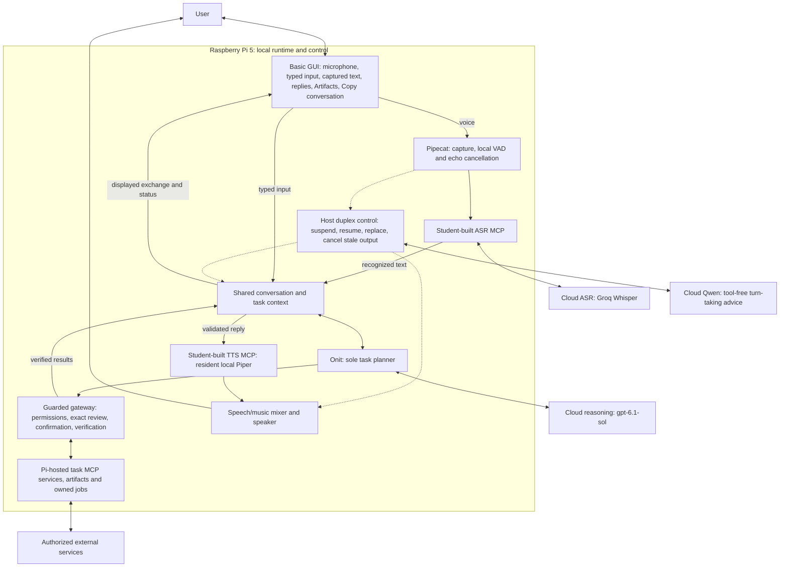

# ME3 | Full-Duplex Voice AI Agent

**Loreen Anne P. De Guzman · AI 231 · Student number 202521201**  
Frozen system and evaluation: **7 November 2026** · Summary updated: **8 November 2026**

ME3 is a Raspberry Pi 5 assistant that accepts **spoken and typed requests**, maintains shared conversation and task context, and uses guarded tools to carry out authorized work. It combines Pipecat, local voice activity detection, student-built speech MCP services, Onit as the sole task planner, and local Piper speech synthesis.

**Assessment: a capable working prototype whose main weakness is response speed and consistency.** Live trials demonstrated useful conversation and task capabilities. Controlled benchmarks showed long reply delays, missed capture windows and incomplete interruption qualification. The results support **partial qualification**, without an overall numerical grade or an all-requirements pass.

## System architecture



The Pi hosts the GUI, audio pipeline, context, planner integration, execution gateway, MCP processes and Piper. Wi-Fi supplies hosted speech recognition, reasoning and online services. Normal operation does not require the engineering laptop or Codex desktop app. **Valid cloud credentials and model access remain required**, including the configured ChatGPT-plan reasoning connection; no automatic reasoner fallback is configured.

Qwen supplies restricted conversational-turn advice. It cannot independently plan tasks, approve actions or execute tools. The Pi host retains control of interruption handling and action safeguards.

| Component | Implementation and execution location |
|---|---|
| ASR: speech recognition | Student-built Python MCP service on the Pi; Groq `whisper-large-v3-turbo` inference in the cloud; English-configured input |
| Main reasoning | Onit using `gpt-6.1-sol` through `openai_chatgpt_plan` |
| Conversational floor advice | Tool-free `qwen/qwen3.8-27b` role; host-validated advice |
| TTS: speech synthesis | Student-built Python MCP service; resident local Piper 1.8.0 |
| Audio and duplex control | Pipecat 1.12.0, local Silero VAD, WebRTC echo cancellation and SmartTurn components |
| Tasks and interface | Guarded Pi-hosted MCP services and the basic voice/text GUI |

The student implementation wraps and integrates existing models; it does not train Whisper, Piper or the main language model from scratch. MCP provides the typed tool interface, with the speech services communicating through standard input/output.

## Prompt, context and interruption handling

The versioned prompt defines ME3 as a general-purpose conversational assistant using **Onit as the sole planner**. Onit interprets requests and selects tools. The host owns authorization, execution, cancellation and independent verification. See [the planner/host policy](ME3Deployment/onit_candidate/engine.py).

Voice transcripts and typed messages enter the same conversation controller. Relevant history, task references, tool results and pending reviews support follow-ups. After discussing focaccia, for example, “add that to my recipe scaler” can refer back to the recipe. Saved artifacts are retrieved through tools and are distinct from temporary conversational context.

Input capture continues during output. Generation and request identities prevent obsolete results from being adopted after a correction. A listening acknowledgment can preserve and resume the same answer; a replacement can invalidate unfinished old output. These behaviors have scoped live demonstrations. Broad background-speech discrimination and physical interruption latency remain incompletely qualified.

## Capabilities and interface

| Area | Demonstrated scope and boundary |
|---|---|
| Conversation | Contextual follow-ups, topic changes, corrections, listening acknowledgments and longer casual exchanges; tool-backed requests can still be slow |
| Voice and text | Both are valid inputs with shared context. Type an unclear name, misrecognized word, correction or complete request, then continue by voice |
| Spanish | Drafting, translation, contextual replies and female Spanish speech demonstrated without a language button; ASR remains English-configured and may need typed clarification |
| Apps and artifacts | Generate and revise supported apps/files, retrieve saved artifacts, open/close in-GUI previews, and manage bounded owned local servers while chatting |
| Research | General web search with source links and related follow-ups demonstrated; source access and availability can fail |
| Productivity | Local records, saved-note-based planning and selected-account Google Calendar creation, retrieval, rescheduling and cancellation; no automatic local/cloud calendar synchronization |
| Media | Scoped local music and supported media/search operations |
| Communication | Scoped Gmail and WhatsApp sending with exact reviews, separate confirmations and outcome evidence; submission, delivery and reading are distinct claims |

The GUI retains a microphone start/restart control, text composer, Ready/Listening/Thinking/Stopping/Stopped indicators, relevant orange notices, task-progress text, Artifacts and **Copy conversation**. Enter/Send submits typed input; Shift+Enter inserts a newline. Copy conversation copies the displayed exchange, not raw audio or hidden journals. Displayed text alone does not prove all speech was played.

English output uses `en_US-ljspeech-medium`. Spanish output uses the separate female `es_ES-sharvard-medium` voice. No formal Spanish recognition, translation-quality or voice-naturalness score was established.

**The frozen configuration contains 14 task-server categories:** utilities, shopping, library, music, reminders, research, YouTube, SoundCloud, WhatsApp, workspace, calling, productivity, Gmail and Google Calendar. Configuration is not blanket permission, universal availability or live qualification of every operation.

## Task safeguards

- Consequential actions require the applicable exact target/content review and separate current human confirmation.
- The host validates tool arguments, grants and current request ownership; model prose cannot supply authorization.
- Workspace execution uses bounded paths, resources and isolated processes. A file write or successful launch alone does not prove a program works.
- Important outcomes require operation-specific readback. Uncertain actions are not automatically replayed.
- Closing an app preview and stopping its background server are separate operations.
- Contextual progress acknowledgments describe attempted work; they do not certify completion or remove the actual reasoning delay.

## Measured benchmark results

The evaluation used the course benchmark pinned to commit `57eaddbc188ce9a19b8fd002b575f703426956f4`. It recorded **30 stage trials** in collection004 and **14 disjoint behavior execution records** across collection006 and collection007. These are recorded executions, not 44 passes or a single uninterrupted run. Earlier failed attempts and missing observations are retained.

| Metric | Observed n | Mean | p95 |
|---|---:|---:|---:|
| Pi digital PCM handoff | 21 | 6.439 s | 7.357 s |
| Rig recorded reply onset | 18 | 7.286 s | 8.014 s |
| Endpointing | 30 | 0.667 s | 0.691 s |
| ASR finalization | 30 | 0.790 s | 1.315 s |
| ASR final to first text | 24 | 4.773 s | 6.169 s |
| TTS request to complete MCP PCM return | 21 | 0.507 s | 0.694 s |

- **Median recorded digital reply onset: 7.348 seconds**, among 18 observed replies.
- **12 of 30 stage trials** had no detected reply within the capture window. This does not establish that no answer was eventually generated.
- **ASR word error rate: 17.68%**: 35 edits across 198 reference words in the fixed stage corpus. This is not a Spanish or universal recognition score.
- Late/missing initial replies prevented scheduled overlaps, leaving **zero eligible interruption-latency measurements**. Live demonstrations remain separate evidence.
- Behavior samples were very small: false turns **1/2**, turn-taking miss **1/1**, and synthetic/Candor pause-turn rates **0/1 each**.
- Judge-dependent semantics were **NOT_SCORED** after a readiness timeout, with zero scoring judge calls. Physical audible onset/stop and detection precision/recall were **NOT_MEASURED**.

These statistics use observed values only. Digital PCM handoff and recorded reply onset are software/rig observations, not physical microphone-to-speaker measurements. TTS processing time does not measure voice naturalness. The [benchmark report](Benchmarks/BENCHMARK_RESULTS.md) contains exact definitions, denominators, missingness, uncertainty and separate collection histories.

## Limitations and release boundary

Response latency and timely-response reliability are the principal measured weaknesses. Provider/network availability can interrupt sessions. A redundant WhatsApp-close request after a verified send and automatic close could stop the conversation; that accepted limitation is retained. Broader language/noise/directedness performance and some master capability criteria remain partial or deferred.

The source restore passed seven focused checks; a complete fresh-OS installation was not demonstrated. Smart-home control and automatic local/Google Calendar synchronization remain deferred. **ME3 publishing its own generated apps to GitHub is not part of this frozen release.**

Frozen measured Pi source-manifest identity:

```text
03d7a144917edb920949c1ebaca116e277cdb55ae5c2589018334f14d522721b
```

This identifies 586 source entries and a separately checked 64-entry native package; it is not a Git commit. Initial repository publication is commit `0594985ac0c64ca797377f89ab889610b88753a1`. Later documentation commits do not change the measured agent or its benchmark results. The sanitized deployment copy discloses substitutions and is not byte-identical to the private measured installation.

## Supporting documents and source

| Document or folder | Contents |
|---|---|
| [Two-page presentation summary](<1 - ME3_PRESENTATION_SUMMARY.pdf>) | Presentation-format architecture, implementation, capabilities and measured results |
| [Product report](<2 - ME3_PRODUCT_REPORT.md>) | Detailed product/technical account and capability boundaries |
| [Architecture diagram and embedded guide](<3 - ME3_ARCHITECTURE.pdf>) | Detailed diagram on page 1 and explanation on page 2 |
| [GUI voice/text guide](<4 - ME3_GUI_VOICE_TEXT_GUIDE.md>) | Normal operation, typed corrections, captured text, Spanish scope and demo preparation |
| [Engineering history](<5 - ME3_ENGINEERING_HISTORY.md>) | Development decisions, retained failures and finite qualification evidence |
| [Benchmarks](Benchmarks/README.md) | Results, method, adapters, provenance and numeric exports |
| [ME3Deployment](ME3Deployment/README.md) | Implementation source, setup, operation, dependencies and reproduction boundaries |
| [REFERENCES](REFERENCES/README.md) | Planning extracts, glossary, original-record provenance and publication file inventory |

The editable [Mermaid architecture source](REFERENCES/ME3_ARCHITECTURE_DETAILED.mmd), [PNG](REFERENCES/ME3_ARCHITECTURE_DETAILED.png) and [SVG](REFERENCES/ME3_ARCHITECTURE_DETAILED.svg) are included. [Submission contents](SUBMISSION_CONTENTS.md) provides the complete reading order.

Credentials, account state, private conversations/contacts/media, raw recordings, environments and model weights are excluded. Four sensitive original logs remain in private custody; included extracts disclose their provenance. Presentation scripts stay in the separate local study folder. No project-wide redistribution license is assumed; existing third-party notices remain in place.
